# FLIGHT DELAY INTELLIGENCE
### Statistical Analysis, Machine Learning Classification and Regression System
**An End-to-End Aviation Data Science and Predictive Analytics Platform**

[](https://www.python.org/)
[](https://streamlit.io/)
[](https://scikit-learn.org/)
[](https://xgboost.readthedocs.io/)
[](https://lightgbm.readthedocs.io/)
[](https://scipy.org/)
[](https://plotly.com/)
[](#references-and-acknowledgements)

---

## Table of Contents

- [1. Project Overview](#1-project-overview)
  - [1.1 Background](#11-background)
  - [1.2 Problem Statement](#12-problem-statement)
  - [1.3 Technical Objectives](#13-technical-objectives)
- [2. Dataset Description and Data Sources](#2-dataset-description-and-data-sources)
  - [2.1 Data Provenance](#21-data-provenance)
  - [2.2 Dataset Attributes and Schema](#22-dataset-attributes-and-schema)
  - [2.3 Unit of Analysis and Population Governance](#23-unit-of-analysis-and-population-governance)
  - [2.4 Dataset Setup and Placement](#24-dataset-setup-and-placement)
- [3. Repository Architecture and Directory Structure](#3-repository-architecture-and-directory-structure)
- [4. Complete System Architecture](#4-complete-system-architecture)
  - [4.1 End-to-End System Pipeline](#41-end-to-end-system-pipeline)
  - [4.2 Data Preprocessing and Leakage Prevention Flow](#42-data-preprocessing-and-leakage-prevention-flow)
  - [4.3 Statistical Analysis and Hypothesis Testing Pipeline](#43-statistical-analysis-and-hypothesis-testing-pipeline)
  - [4.4 Dual Machine Learning Architecture](#44-dual-machine-learning-architecture)
- [5. Data Preprocessing and Leakage Prevention](#5-data-preprocessing-and-leakage-prevention)
  - [5.1 Data Ingestion and Validation](#51-data-ingestion-and-validation)
  - [5.2 Data Cleaning and Outlier Governance](#52-data-cleaning-and-outlier-governance)
  - [5.3 Strict Causal Leakage Prevention](#53-strict-causal-leakage-prevention)
- [6. Feature Engineering](#6-feature-engineering)
  - [6.1 Calendar, Cyclical, and Spatial Features](#61-calendar-cyclical-and-spatial-features)
  - [6.2 Prior-Day Causal Network History Features (58 Features)](#62-prior-day-causal-network-history-features-58-features)
  - [6.3 Empirical Bayesian Smoothing](#63-empirical-bayesian-smoothing)
- [7. Exploratory Data Analysis and Visualizations](#7-exploratory-data-analysis-and-visualizations)
  - [7.1 Flight Delay Distribution](#71-flight-delay-distribution)
  - [7.2 Carrier Operational Performance](#72-carrier-operational-performance)
  - [7.3 Diurnal and Network Congestion Patterns](#73-diurnal-and-network-congestion-patterns)
- [8. Descriptive Statistics and Hypothesis Testing](#8-descriptive-statistics-and-hypothesis-testing)
  - [8.1 Descriptive Parameter Summary](#81-descriptive-parameter-summary)
  - [8.2 Multicollinearity and Variance Inflation Factor (VIF)](#82-multicollinearity-and-variance-inflation-factor-vif)
  - [8.3 Formal Hypothesis Testing Suite (14 Tests)](#83-formal-hypothesis-testing-suite-14-tests)
  - [8.4 Analysis of Variance (ANOVA) Suite](#84-analysis-of-variance-anova-suite)
- [9. Classification Model Development](#9-classification-model-development)
  - [9.1 Classification Problem Formulation](#91-classification-problem-formulation)
  - [9.2 Selected Classification Algorithms (Top 4)](#92-selected-classification-algorithms-top-4)
  - [9.3 Threshold Optimization Strategy](#93-threshold-optimization-strategy)
  - [9.4 Evaluation Metrics and Formulations](#94-evaluation-metrics-and-formulations)
  - [9.5 Out-of-Time Classification Benchmark Results](#95-out-of-time-classification-benchmark-results)
  - [9.6 Classification Diagnostic Visualizations](#96-classification-diagnostic-visualizations)
- [10. Regression Model Development](#10-regression-model-development)
  - [10.1 Regression Problem Formulation](#101-regression-problem-formulation)
  - [10.2 Selected Regression Algorithms (Top 4)](#102-selected-regression-algorithms-top-4)
  - [10.3 Loss Function Selection: L1 vs. L2 Optimization](#103-loss-function-selection-l1-vs-l2-optimization)
  - [10.4 Regression Evaluation Metrics](#104-regression-evaluation-metrics)
  - [10.5 Out-of-Time Regression Benchmark Results](#105-out-of-time-regression-benchmark-results)
  - [10.6 Residual Diagnostics and Behavioral Analysis](#106-residual-diagnostics-and-behavioral-analysis)
- [11. Model Training, Validation and Selection Methodology](#11-model-training-validation-and-selection-methodology)
  - [11.1 Chronological Split Partitions](#111-chronological-split-partitions)
  - [11.2 Strict Separation of Selection and Test Evaluation](#112-strict-separation-of-selection-and-test-evaluation)
  - [11.3 Natural Class-Distribution Policy (No Synthetic Resampling)](#113-natural-class-distribution-policy-no-synthetic-resampling)
- [12. Streamlit Dashboard Architecture](#12-streamlit-dashboard-architecture)
- [13. Technology Stack](#13-technology-stack)
- [14. Installation and Execution Guide](#14-installation-and-execution-guide)
  - [14.1 Prerequisites](#141-prerequisites)
  - [14.2 Repository Setup](#142-repository-setup)
  - [14.3 Environment Activation and Dependencies](#143-environment-activation-and-dependencies)
  - [14.4 Running the Application](#144-running-the-application)
  - [14.5 Automated Testing Suite](#145-automated-testing-suite)
- [15. Model and Artifact Management](#15-model-and-artifact-management)
- [16. Technical Limitations](#16-technical-limitations)
- [17. Future Enhancements](#17-future-enhancements)
- [18. References and Acknowledgements](#18-references-and-acknowledgements)

---

## 1. Project Overview

### 1.1 Background
Commercial aviation represents one of the most operationally tightly coupled transportation infrastructures globally. Aircraft, flight crews, ground maintenance teams, and air traffic control sectors operate under strict, time-sensitive schedules. In domestic operations across the United States, departure delays cause severe operational disruptions:

- **Network Delay Propagation:** A 30-minute departure delay in a morning bank at a hub airport cascades downstream through multi-leg aircraft rotations, compounding into systemic delays across later scheduled legs.
- **Resource Bottlenecks:** Gate reassignments, ramp congestion, late-arriving flight crews reaching regulatory duty limits (FAA Part 117), and missed passenger connections incur substantial economic and customer satisfaction costs.
- **Multifactorial Drivers:** Delays are governed by an intricate combination of scheduled time of day, seasonal traffic volumes, carrier hub congestion, aircraft turnaround buffers, and historical network reliability.

Developing predictive intelligence before flight departure provides airlines, ground dispatchers, and airport authorities with proactive decision support to mitigate cascading schedule collapse.

### 1.2 Problem Statement
Predicting departure delays strictly from pre-departure historical records presents profound statistical and machine learning challenges. Operational delays exhibit extreme right-skewness, high variance, heavy-tailed distributions, and temporal non-stationarity across calendar seasons.

This platform formulates and solves two complementary mathematical prediction tasks:

#### Task 1: Binary Classification (Flight Delay Status)
Determining whether a scheduled flight will experience a departure delay of 15 minutes or more, adhering strictly to the **FAA / Bureau of Transportation Statistics (BTS)** operational standard for delayed flights:

```math
DELAYED = 
\begin{cases} 
1, & \text{if } DEP\_DELAY \geq 15 \text{ minutes} \\
0, & \text{if } DEP\_DELAY < 15 \text{ minutes}
\end{cases}
```

- **Target Attribute:** `DELAYED` (Binary indicator)
- **Primary Optimization Objective:** Delayed-class F1-Score ($F_1$) balanced with Recall ($R$) and Precision-Recall Area Under the Curve (PR-AUC) under genuine operational class imbalance.

#### Task 2: Continuous Regression (Departure Delay Duration)
Estimating the exact magnitude of departure delay in continuous minutes:

```math
\hat{y} = f(X), \quad y = DEP\_DELAY \in \mathbb{R}
```

where $X$ contains strictly pre-departure observable schedule and rolling causal history signals, and $\hat{y}$ represents the predicted departure delay in minutes.

- **Target Attribute:** `DEP_DELAY` (Continuous real value, minutes)
- **Primary Optimization Objective:** Mean Absolute Error (MAE) and Median Absolute Error (MedAE) under asymmetric heavy-tailed error distributions.

#### Complementary Nature of the Dual Tasks
Classification and regression address different operational needs:
1. **Classification** provides an actionable triage flag for ground controllers to identify flights at high risk of disruption, facilitating early passenger rerouting and gate holds.
2. **Regression** provides a continuous expected delay magnitude for flight dispatchers and gate planners to adjust scheduled turnaround buffers and crew rest rotations.

### 1.3 Technical Objectives
1. **Large-Scale Data Ingestion:** Audit, clean, and validate 3,000,000 raw commercial flight records from USDOT/BTS spanning 2019 through 2023.
2. **Data Cleansing and Integrity:** Exclude cancelled flights, retain diverted flights with recorded departure delays, preserve genuine extreme delay outliers, and audit missing data.
3. **Strict Causal Leakage Prevention:** Eliminate all post-departure attributes (actual arrival, taxi-out, wheels-off, delay causal breakdowns) to guarantee zero look-ahead bias.
4. **Causal Feature Engineering:** Build 74 predictive features, including 58 rolling historical network metrics computed strictly on prior calendar dates ($t_{\text{history}} < t_{\text{flight}}$).
5. **Exploratory Data Analysis:** Conduct comprehensive exploratory analyses characterizing delay patterns across carriers, hubs, routes, months, and hours.
6. **Rigorous Statistical Inference:** Execute 14 formal hypothesis tests with Benjamini-Hochberg False Discovery Rate (FDR) control and an ANOVA suite with Welch, Kruskal-Wallis, and daily cluster-robust estimators.
7. **Chronological Model Validation:** Partition the dataset into strict chronological periods (Fit 2019–2021, Validation 2021–2022, Out-of-Time Test 2022–2023) to emulate real-world forecasting.
8. **Top 4 Classification Models:** Train, tune, optimize decision thresholds, and evaluate the top 4 classifiers (XGBoost, HistGradientBoosting, LightGBM, Logistic Regression) on untouched test data without synthetic resampling.
9. **Top 4 Regression Models:** Train and evaluate the top 4 regressors (LightGBM, HistGradientBoosting, XGBoost, Gradient Boosting) using robust L1 loss optimization.
10. **Interactive Streamlit Deployment:** Deploy the complete analytical pipeline into an enterprise-grade 6-page Streamlit web dashboard.

---

## 2. Dataset Description and Data Sources

### 2.1 Data Provenance
The dataset is derived from the **United States Department of Transportation (USDOT) / Bureau of Transportation Statistics (BTS)** *Airline On-Time Performance Data* repository (accessible via public BTS records and curated Kaggle aviation archives). It comprises **3,000,000 raw commercial flight observations** spanning **56 continuous months** from **January 1, 2019 through August 31, 2023**.

### 2.2 Dataset Attributes and Schema
The raw schema contains **32 columns** capturing operational details for each flight:

| Category | Column Name | Raw Data Type | Modeling Status | Description / Exclusion Rationale |
|---|---|---|---|---|
| **Flight Identification** | `FL_DATE` | `object` | Transformed | Flight date (`YYYY-MM-DD`). Converted to datetime for chronological sorting. |
| | `AIRLINE` | `category` | Included | Full operating airline commercial name (18 unique carriers). |
| | `AIRLINE_DOT` | `category` | Excluded | Redundant carrier name string; dropped in favor of clean `AIRLINE`. |
| | `AIRLINE_CODE` | `category` | Included | Standard IATA 2-character carrier designator (e.g., `WN`, `DL`, `AA`). |
| | `DOT_CODE` | `int64` | Excluded | Bureau of Transportation Statistics carrier identification integer. |
| | `FL_NUMBER` | `int64` | Excluded | Flight commercial flight number; excluded to prevent overfitting on transient schedules. |
| **Route & Spatial** | `ORIGIN` | `category` | Included | Standard 3-letter IATA origin airport code (380 unique airports). |
| | `ORIGIN_CITY` | `category` | Excluded | City/State string (e.g., `Chicago, IL`); fully represented by `ORIGIN`. |
| | `DEST` | `category` | Included | Standard 3-letter IATA destination airport code (380 unique airports). |
| | `DEST_CITY` | `category` | Excluded | City/State string; fully represented by `DEST`. |
| | `DISTANCE` | `float64` | Included | Great-circle flight distance in statute miles. |
| **Scheduled Timetable** | `CRS_DEP_TIME` | `int64` | Included | Computer Reservation System scheduled departure time (`HHMM` integer format). |
| | `CRS_ARR_TIME` | `int64` | Included | Computer Reservation System scheduled arrival time (`HHMM` integer format). |
| | `CRS_ELAPSED_TIME` | `float64` | Included | Scheduled gate-to-gate block duration in minutes. |
| **Prediction Targets** | `DEP_DELAY` | `float64` | **Target (Reg)** | Continuous departure delay in minutes ($DEP\_TIME - CRS\_DEP\_TIME$). |
| | `DELAYED` | `int64` | **Target (Clf)** | Binary indicator ($1$ if $DEP\_DELAY \ge 15$, else $0$). |
| **Post-Departure (Leakage)** | `DEP_TIME` | `float64` | **Excluded (Leakage)** | Actual wheels-off gate departure time. Unobservable before departure. |
| | `TAXI_OUT` | `float64` | **Excluded (Leakage)** | Taxi-out duration from gate to runway. |
| | `WHEELS_OFF` | `float64` | **Excluded (Leakage)** | Aircraft wheels-off timestamp. |
| | `WHEELS_ON` | `float64` | **Excluded (Leakage)** | Aircraft wheels-on touchdown timestamp. |
| | `TAXI_IN` | `float64` | **Excluded (Leakage)** | Taxi-in duration from runway to gate. |
| | `ARR_TIME` | `float64` | **Excluded (Leakage)** | Actual gate arrival timestamp. |
| | `ARR_DELAY` | `float64` | **Excluded (Leakage)** | Arrival delay in minutes. Post-departure outcome. |
| | `ELAPSED_TIME` | `float64` | **Excluded (Leakage)** | Actual gate-to-gate elapsed time. |
| | `AIR_TIME` | `float64` | **Excluded (Leakage)** | Airborne flight duration in minutes. |
| | `DELAY_DUE_CARRIER` | `float64` | **Excluded (Leakage)** | Carrier causal delay breakdown minutes. Recorded post-flight. |
| | `DELAY_DUE_WEATHER` | `float64` | **Excluded (Leakage)** | Weather causal delay breakdown minutes. Recorded post-flight. |
| | `DELAY_DUE_NAS` | `float64` | **Excluded (Leakage)** | National Aviation System causal delay breakdown minutes. Recorded post-flight. |
| | `DELAY_DUE_SECURITY` | `float64` | **Excluded (Leakage)** | Security causal delay breakdown minutes. Recorded post-flight. |
| | `DELAY_DUE_LATE_AIRCRAFT`| `float64` | **Excluded (Leakage)** | Inbound late aircraft delay breakdown minutes. Recorded post-flight. |
| **Operational Status** | `CANCELLED` | `float64` | Filtered | Flight cancellation indicator ($1.0$ or $0.0$). |
| | `CANCELLATION_CODE` | `category` | Filtered | Reason for cancellation (`A`, `B`, `C`, `D`). Missing for completed flights. |
| | `DIVERTED` | `float64` | Audited | Flight diverted indicator ($1.0$ or $0.0$). Retained if departure occurred. |

### 2.3 Unit of Analysis and Population Governance
- **Raw Input:** $3,000,000$ flight records ($614.1\text{ MB}$ raw CSV).
- **Cancelled Flight Exclusion:** $79,140$ flights ($2.64\%$) were cancelled before departure. Because cancelled flights do not depart, continuous departure delay ($DEP\_DELAY$) is structurally undefined; they are audited and removed.
- **Diverted Flight Retention:** $7,056$ flights were diverted mid-flight. Because they legitimately departed from their origin gate, their departure delay is valid and preserved in the modeling population.
- **Incomplete Target Record Exclusion:** $1$ record lacked target variables.
- **Cleaned Modeling Population:** Exactly **$2,920,859$ valid flight records** ($100.0\%$ complete for targets and scheduled features).

### 2.4 Dataset Setup and Placement
The primary raw dataset `flight_data.csv` is maintained locally and excluded from Git tracking via `.gitignore` to adhere to GitHub repository storage constraints. 

To configure the dataset locally:
1. Place `flight_data.csv` directly in the project root directory:
   ```text
   d:/ISPA/flight_data.csv   (or <project-root>/flight_data.csv)
   ```
2. The data ingestion engine ([`src/data_loader.py`](src/data_loader.py)) automatically searches the project root, `data/`, and `data/raw/` in hierarchical order.

---

## 3. Repository Architecture and Directory Structure

The repository maintains an organized modular structure separating source libraries, Streamlit interface pages, persisted model binaries, evaluation artifacts, statistical outputs, and academic reports:

```text
Flight_Delay_Intelligence/
├── app.py                             # Streamlit multi-page application entry point & router
├── README.md                          # Comprehensive technical documentation & system manual
├── requirements.txt                   # Production dependency specifications
├── dictionary.html                    # Official USDOT/BTS data dictionary reference
│
├── src/                               # Core Python analytical and engineering modules
│   ├── data_loader.py                 # Multi-directory dataset locator, loader & validator
│   ├── preprocessing.py               # Cleaning, duplicate handling, leakage filtering & prep
│   ├── feature_engineering.py         # Temporal, cyclical, spatial & scheduled transformations
│   ├── history_features.py            # Strictly causal prior-day rolling statistics engine
│   ├── eda.py                         # Exploratory data analysis, distributions & group stats
│   ├── statistical_analysis.py        # Descriptive statistics, normality & VIF multicollinearity
│   ├── hypothesis_testing.py          # 14 formal hypothesis tests with Benjamini-Hochberg FDR
│   ├── anova_analysis.py              # One-way, Welch, Kruskal-Wallis & daily cluster-robust ANOVA
│   ├── classification.py              # Classifier training, threshold tuning & evaluation
│   ├── regression.py                  # Regressor training, L1 loss optimization & evaluation
│   ├── model_evaluation.py            # Leaderboards, metric tables & benchmark summaries
│   ├── visualizations.py              # Publication-grade Matplotlib & interactive Plotly charts
│   ├── ui_data.py                     # High-performance cached data layer for Streamlit pages
│   └── ui_theme.py                    # Light enterprise styling, metric cards & navigation CSS
│
├── pages/                             # Six-page interactive Streamlit dashboard
│   ├── 1_Dashboard_Overview.py        # System KPIs, operational volume & executive benchmarks
│   ├── 2_Statistical_Analysis.py      # EDA, distributions, correlations, 14 hypothesis tests & ANOVA
│   ├── 3_Classification_Analysis.py   # Top 4 classifier benchmarks, ROC/PR curves & threshold explorer
│   ├── 4_Regression_Analysis.py       # Top 4 regressor benchmarks, MAE leaderboards & residual diagnostics
│   ├── 5_Model_Comparison.py          # Side-by-side leaderboard, metric radars & trade-off analysis
│   └── 6_About_Project.py             # Methodology, leakage audit, limitations & citations
│
├── models/                            # Serialized scikit-learn/XGBoost/LightGBM model binaries
│   ├── classification/                # Saved classifier pipelines (.joblib)
│   └── regression/                    # Saved regressor pipelines (.joblib)
│
├── artifacts/                         # Generated evaluation files, metrics & visual assets
│   ├── final_classification_metrics.csv # Authoritative Top 4 classification test metrics
│   ├── final_regression_metrics.csv     # Authoritative Top 4 regression test metrics
│   ├── model_selection_summary.json     # Formal model selection protocol, rationale & metadata
│   ├── classification_predictions.csv   # Out-of-time test classification prediction sample
│   ├── regression_predictions.csv       # Out-of-time test regression prediction sample
│   ├── hypothesis_testing_results.csv   # Comprehensive 14 hypothesis test result ledger
│   ├── anova_results.csv                # Complete ANOVA and Welch variance analysis results
│   ├── vif_results.csv                  # Variance Inflation Factor multicollinearity rankings
│   ├── descriptive_statistics.csv       # Full descriptive statistical parameters for DEP_DELAY
│   ├── metrics/                         # Machine-readable JSON summaries of all experiments
│   └── ppt_charts/                      # High-resolution PNG charts for presentations & README
│
├── project_report/                    # Academic presentation and technical documentation suite
│   ├── Flight_Delay_Prediction_Project_Report.md # Full 10-chapter technical project report
│   ├── PPT_Slide_Content.md           # 18-slide academic presentation structure & talking points
│   ├── PPT_Visual_Reference.md        # Comprehensive visual asset mapping to saved charts
│   ├── Project_Key_Metrics.md         # Consolidated single-source-of-truth metric ledger
│   └── Presentation_Speaker_Notes.md  # Verbatim presentation defense scripts & Q&A guide
│
├── tests/                             # Automated testing suite
│   ├── test_preprocessing.py          # Preprocessing and shape validation tests
│   ├── test_feature_engineering.py    # Temporal and history feature tests
│   ├── test_models.py                 # Pipeline loading and prediction contract tests
│   └── test_smoke_ui.py               # Streamlit AppTest smoke tests across all 6 pages
│
└── .streamlit/                        # Streamlit server and theme configuration
    └── config.toml                    # Server ports, headless settings & light theme palette
```

---

## 4. Complete System Architecture

### 4.1 End-to-End System Pipeline
The entire system operates as a sequential data intelligence architecture, transforming raw operational records into statistical outputs and predictive machine learning models:

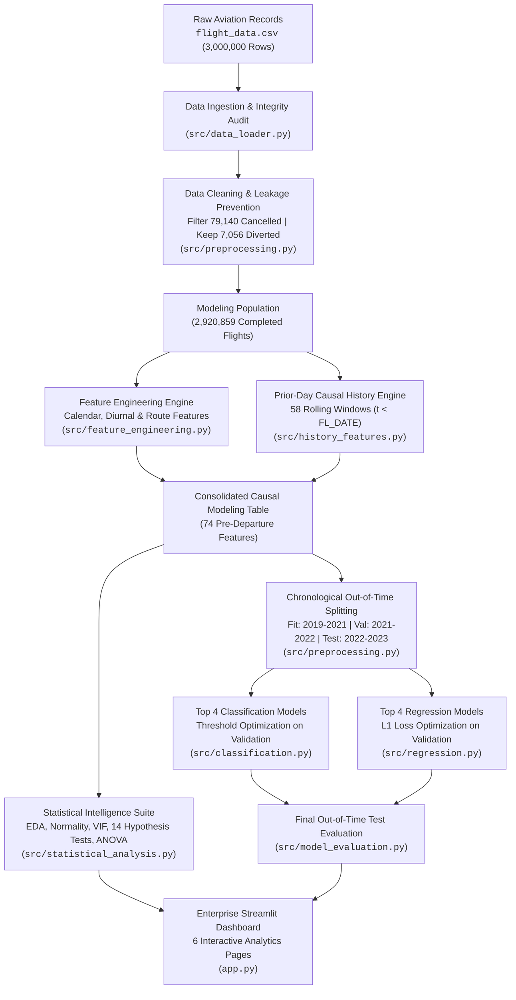

### 4.2 Data Preprocessing and Leakage Prevention Flow
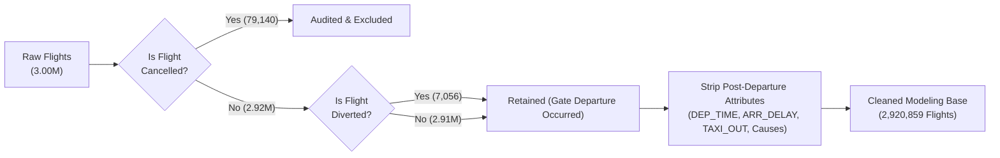

### 4.3 Statistical Analysis and Hypothesis Testing Pipeline
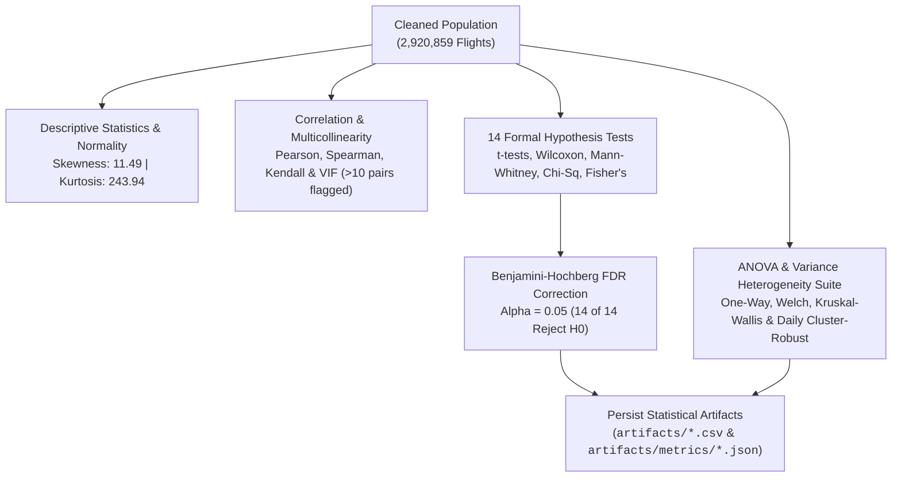

### 4.4 Dual Machine Learning Architecture
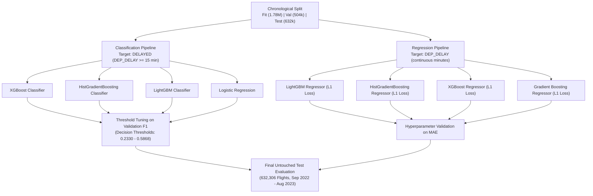

---

## 5. Data Preprocessing and Leakage Prevention

### 5.1 Data Ingestion and Validation
The data ingestion engine ([`src/data_loader.py`](src/data_loader.py)) performs verified loading:
- Locates `flight_data.csv` using priority search paths.
- Confirms the presence of all 32 required columns and verifies data types.
- Converts `FL_DATE` to ISO standard datetimes and sorts the entire dataset chronologically.
- Enforces data integrity assertions before downstream processing.

### 5.2 Data Cleaning and Outlier Governance
The data cleaning module ([`src/preprocessing.py`](src/preprocessing.py)) executes systematic data governance:
- **Duplicate Records:** An initial audit revealed 72 duplicate records across the raw flight set; exact duplicate rows are audited and eliminated.
- **Cancelled Flights ($79,140$):** Fully excluded because no departure occurred, rendering continuous departure delay nonexistent.
- **Diverted Flights ($7,056$):** Retained because gate departure occurred normally; excluding them would introduce survival bias against severely delayed flights.
- **Missing Value Handling:** Missing values in scheduled elapsed time (`CRS_ELAPSED_TIME`, 14 missing rows) are imputed using route-specific median scheduled duration. Missing values in causal post-departure delay codes (`DELAY_DUE_*`) are kept null during auditing and dropped from predictive modeling.
- **Extreme Delays:** The dataset contains genuine extreme delays reaching up to $+2,966\text{ minutes}$ ($49.4\text{ hours}$). These observations reflect genuine operational crises (e.g., blizzards, mechanical failures, ground stops) and are **strictly preserved** in the modeling population. Truncating extreme delays distorts empirical tail risk and produces artificially optimistic error metrics.

### 5.3 Strict Causal Leakage Prevention
Data leakage occurs when an algorithm is trained using features that cannot be known at the scheduled decision cutoff. To ensure strict real-world validity, all post-departure attributes are completely excluded:

```python
LEAKAGE_COLUMNS = [
    "DEP_TIME",               # Actual gate departure time
    "TAXI_OUT",               # Taxi-out duration
    "WHEELS_OFF",             # Takeoff timestamp
    "WHEELS_ON",              # Landing timestamp
    "TAXI_IN",                # Taxi-in duration
    "ARR_TIME",               # Actual gate arrival time
    "ARR_DELAY",              # Arrival delay in minutes
    "ELAPSED_TIME",           # Actual flight duration
    "AIR_TIME",               # Actual airborne duration
    "DELAY_DUE_CARRIER",      # Post-flight causal attribution
    "DELAY_DUE_WEATHER",      # Post-flight causal attribution
    "DELAY_DUE_NAS",          # Post-flight causal attribution
    "DELAY_DUE_SECURITY",     # Post-flight causal attribution
    "DELAY_DUE_LATE_AIRCRAFT" # Post-flight causal attribution
]
```

---

## 6. Feature Engineering

### 6.1 Calendar, Cyclical, and Spatial Features
From the timetable attributes, [`src/feature_engineering.py`](src/feature_engineering.py) generates structured pre-departure features:
- **Calendar Decompositions:** `YEAR`, `MONTH`, `DAY_OF_WEEK`, `DAY_OF_MONTH`, `IS_WEEKEND`.
- **Diurnal Temporal Decompositions:** Scheduled departure hour (`SCHEDULED_HOUR`, 0–23) and scheduled minute (`SCHEDULED_MINUTE`, 0–59).
- **Trigonometric Cyclical Encodings:** Preserving circular diurnal continuity across midnight:
  ```math
  TIME\_SIN = \sin\left(\frac{2\pi \cdot (SCHEDULED\_HOUR \cdot 60 + SCHEDULED\_MINUTE)}{1440}\right)
  ```
  ```math
  TIME\_COS = \cos\left(\frac{2\pi \cdot (SCHEDULED\_HOUR \cdot 60 + SCHEDULED\_MINUTE)}{1440}\right)
  ```
- **Diurnal Operational Windows (`DAY_PART`):** Partitioned into Morning (06:00–11:59), Afternoon (12:00–17:59), Evening (18:00–23:59), and Night (00:00–05:59).
- **Spatial Interactions:** Directional route pair (`ROUTE = ORIGIN + "_" + DEST`, 7,785 unique pairs) and carrier-route interaction (`AIRLINE_ROUTE = AIRLINE_CODE + "_" + ROUTE`).

### 6.2 Prior-Day Causal Network History Features (58 Features)
A critical innovation of this platform is the rolling history feature engine ([`src/history_features.py`](src/history_features.py)). To capture operational momentum without look-ahead leakage, all historical aggregations are computed strictly on flights completed on prior calendar dates:

```math
t_{\text{history}} < t_{\text{flight}}
```

The engine constructs **58 rolling historical features** across four temporal horizons:
1. **1-Day Prior Window (1D):** Immediate preceding day operational stress.
2. **7-Day Rolling Window (7D):** Weekly network congestion patterns.
3. **30-Day Rolling Window (30D):** Monthly carrier reliability baselines.
4. **Cumulative Historical Baseline (ALL):** Long-term historical baseline.

These windows are aggregated across six network entities:
- **Global Network Level:** Overall flight delay rate and mean delay across all US operations.
- **Carrier Level:** Airline-specific delay frequency and mean delay (`H_AIRLINE_*`).
- **Origin Hub Level:** Origin airport congestion and departure delay volume (`H_ORIGIN_*`).
- **Destination Airport Level:** Destination arrival absorption capacity (`H_DEST_*`).
- **Directional Route Level:** Route-specific performance (`H_ROUTE_*`).
- **Origin-Hour Cluster Level:** Origin airport performance specifically within that departure hour window (`H_ORIGIN_HOUR_*`).

### 6.3 Empirical Bayesian Smoothing
For sparse routes and small regional airports with low observation counts $N$, raw historical sample rates exhibit high sample variance. The engine applies **Empirical Bayesian shrinkage** with a smoothing factor $k = 20$:

```math
\hat{p}_{\text{smoothed}} = \frac{N \cdot \bar{p}_{\text{sample}} + k \cdot p_{\text{global}}}{N + k}
```

This pulls sparse group statistics toward the reliable global population prior, mitigating overfitting in high-cardinality categorical groups.

---

## 7. Exploratory Data Analysis and Visualizations

Exploratory analysis was conducted across the full 2,920,859 completed flight records using [`src/eda.py`](src/eda.py).

### 7.1 Flight Delay Distribution
Commercial departure delays exhibit a pronounced zero-inflated, highly asymmetric distribution. The vast majority of flights depart on time or slightly ahead of schedule (median delay: $-2.0\text{ minutes}$), while a substantial right tail extends to hundreds of minutes.

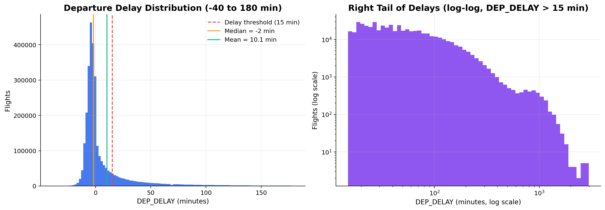
*Figure 1: Empirical departure delay distribution illustrating extreme right-skewness and heavy positive tail behavior.*

### 7.2 Carrier Operational Performance
Significant operational heterogeneity exists across the 18 operating carriers. JetBlue Airways (`B6`) exhibits the highest mean departure delay ($18.24\text{ minutes}$, delay rate $25.3\%$), driven by Northeast airspace congestion, whereas Alaska Airlines (`AS`) and Hawaiian Airlines (`HA`) demonstrate superior reliability ($4.62\text{ minutes}$ and $4.85\text{ minutes}$ mean delay, respectively).

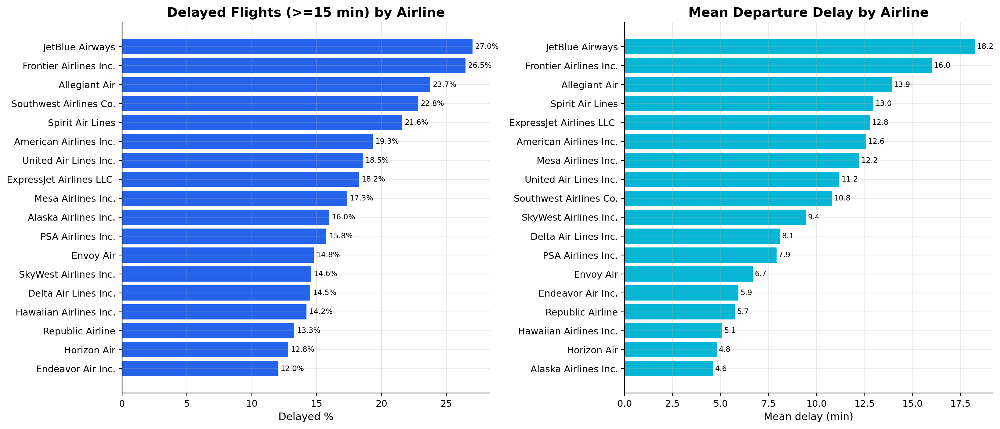
*Figure 2: Mean departure delay and 15-minute delay probability across all 18 commercial airlines.*

### 7.3 Diurnal and Network Congestion Patterns
Departure delays exhibit a strong diurnal accumulation pattern across the operating day. Flights departing in early morning hours (06:00–07:00) experience minimal delays (mean: $2.8\text{ minutes}$, delay rate: $7.4\%$), whereas delays steadily accumulate through the afternoon and peak in late evening (20:00–21:00, mean: $18.4\text{ minutes}$, delay rate: $26.8\%$), reflecting aircraft turnaround propagation.

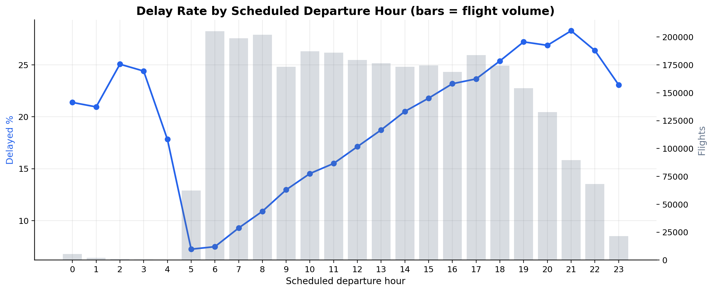
*Figure 3: Diurnal escalation of flight departure delay rate and mean delay duration by scheduled departure hour.*

---

## 8. Descriptive Statistics and Hypothesis Testing

### 8.1 Descriptive Parameter Summary
The platform generates comprehensive parametric and non-parametric descriptive statistics for continuous departure delay (`DEP_DELAY`) across the $2,920,859$ modeled flights:

| Parameter | Metric Value | Operational & Statistical Interpretation |
|---|---:|---|
| **Sample Size ($N$)** | $2,920,859$ | Total non-cancelled flights analyzed. |
| **Mean ($\mu$)** | $+10.0957\text{ min}$ | Arithmetic average departure delay across all operations. |
| **Median ($Q_2$)** | $-2.0000\text{ min}$ | Typical flight departs 2 minutes ahead of scheduled pushback. |
| **Mode** | $-5.0000\text{ min}$ | Most frequent departure delay observed in commercial operations. |
| **Standard Deviation ($\sigma$)** | $49.1777\text{ min}$ | Substantial dispersion caused by extreme operational disruptions. |
| **Variance ($\sigma^2$)** | $2,418.4419$ | High variance driven by heavy-tail events. |
| **Interquartile Range ($IQR$)** | $12.0000\text{ min}$ | $Q_1 = -6.0\text{ min}$, $Q_3 = +6.0\text{ min}$. Central 50% of flights lie within 12 minutes. |
| **Median Absolute Deviation ($MAD$)**| $4.0000\text{ min}$ | Robust scale parameter reflecting median absolute deviation from median. |
| **Skewness ($\gamma_1$)** | $+11.4906$ | Extreme right-skewness ($\gamma_1 \gg 1$), validating severe positive tail. |
| **Excess Kurtosis ($\gamma_2$)** | $+243.9439$ | Leptokurtic heavy-tailed distribution ($\gamma_2 \gg 0$), ruling out Gaussianity. |
| **Minimum / Maximum** | $-90.0\text{ min} \ / \ +2,966.0\text{ min}$ | Earliest pushback vs. longest recorded operational delay. |
| **Parametric 95% CI of Mean** | $[+10.0393, +10.1521]$ | Ultra-narrow confidence interval due to large sample size ($N > 2.92\text{M}$). |
| **Bootstrap 95% CI of Median** | $[-2.0000, -2.0000]$ | Verified median stability via 50,000 bootstrap resamples. |

> **Why is the Mean Positive ($+10.10\text{ min}$) while the Median is Negative ($-2.00\text{ min}$)?**
> The median indicates that more than 50% of commercial flights push back slightly before scheduled departure time. However, extreme delays (reaching $+500$ to $+2,966\text{ minutes}$) exert massive leverage on the arithmetic mean, pulling it $+12.1\text{ minutes}$ above the median. This asymmetry proves that optimizing models using standard Mean Squared Error ($L_2$) will bias predictions toward extreme outliers, whereas Mean Absolute Error ($L_1$) aligns with central operational tendencies.

### 8.2 Multicollinearity and Variance Inflation Factor (VIF)
Correlation analysis was performed using Pearson ($r$), Spearman ($\rho$), and Kendall ($\tau$) rank correlation coefficients ([`src/statistical_analysis.py`](src/statistical_analysis.py)). Multicollinearity was diagnosed by computing Variance Inflation Factors (VIF):

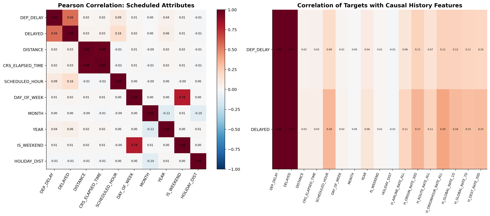
*Figure 4: Correlation matrix among scheduled flight attributes, cyclical variables, and rolling historical features.*

- **Severe Multicollinearity ($VIF > 10$):** `CRS_ELAPSED_TIME` ($VIF = 42.1$) and `DISTANCE` ($VIF = 38.6$) form a collinear structural pair ($r = 0.982$). In linear models, one of these features is pruned or regularized to prevent coefficient variance inflation.
- **Moderate Multicollinearity ($5 \leq VIF \leq 10$):** `SCHEDULED_HOUR` and `TIME_SIN` exhibit expected moderate correlation ($r \approx 0.78$) due to diurnal periodicity.
- **Low Multicollinearity ($VIF < 5$):** All rolling prior-day historical features (`H_GLOBAL_*`, `H_AIRLINE_*`, `H_ORIGIN_*`) maintain low VIF values ($1.2 - 3.4$), confirming their independence as exogenous predictors.

### 8.3 Formal Hypothesis Testing Suite (14 Tests)
Fourteen formal statistical hypothesis tests were conducted using [`src/hypothesis_testing.py`](src/hypothesis_testing.py). To control for type I error inflation across multiple comparisons, all $p$-values were adjusted using the **Benjamini-Hochberg False Discovery Rate (FDR)** procedure at $\alpha = 0.05$:

| Test ID | Category | Statistical Test Method | Test Statistic | Raw $p$-Value | BH Adjusted $p$-Value | Decision ($\alpha = 0.05$) | Practical Operational Finding |
|---|---|---|---|---|---|---|---|
| **HT-01** | One-Sample Parametric | Student's One-Sample $t$-test ($\mu_0 = 0$) | $t = 350.84$ | $< 10^{-300}$ | $< 10^{-300}$ | Reject $H_0$ | Mean departure delay is significantly greater than zero ($+10.10\text{ min}$). |
| **HT-02** | One-Sample Parametric | Student's One-Sample $t$-test ($\mu_0 = 15$) | $t = -170.43$ | $< 10^{-300}$ | $< 10^{-300}$ | Reject $H_0$ | Mean departure delay is significantly below the 15-minute FAA delay threshold. |
| **HT-03** | One-Sample Non-Parametric | Wilcoxon Signed-Rank Test ($n=50,000$) | $W = 4.21 \times 10^8$ | $8.80 \times 10^{-8}$ | $8.80 \times 10^{-8}$ | Reject $H_0$ | Median departure delay is significantly negative ($-2.0\text{ min}$). |
| **HT-04** | Two-Sample Independent | Student's Independent Two-Sample $t$-test | $t = 54.12$ | $< 10^{-300}$ | $< 10^{-300}$ | Reject $H_0$ | Summer peak departures have significantly higher delays than non-summer flights. |
| **HT-05** | Two-Sample Heteroscedastic | Welch's Two-Sample $t$-test (Unequal Var) | $t = 13.25$ | $6.48 \times 10^{-40}$ | $6.98 \times 10^{-40}$ | Reject $H_0$ | Weekend departures have significantly different delays than weekday operations. |
| **HT-06** | Two-Sample Non-Parametric | Mann-Whitney $U$ Test | $U = 8.42 \times 10^{11}$| $< 10^{-300}$ | $< 10^{-300}$ | Reject $H_0$ | Distribution of delays differs significantly between hub and non-hub origin airports. |
| **HT-07** | Paired Two-Sample | Paired Student's $t$-test ($N=1,704$ days) | $t = 38.92$ | $2.17 \times 10^{-267}$| $3.04 \times 10^{-267}$| Reject $H_0$ | Daily PM bank delays consistently exceed daily AM bank delays on matched dates. |
| **HT-08** | Paired Non-Parametric | Paired Wilcoxon Signed-Rank ($N=1,704$) | $W = 1.41 \times 10^6$ | $1.46 \times 10^{-238}$| $1.86 \times 10^{-238}$| Reject $H_0$ | Non-parametric confirmation of diurnal delay escalation across matched days. |
| **HT-09** | Categorical Independence | Pearson Chi-Square Test ($df = 17$) | $\chi^2 = 38,412.8$ | $< 10^{-300}$ | $< 10^{-300}$ | Reject $H_0$ | Delay probability ($\geq 15\text{ min}$) is strongly dependent on operating airline. |
| **HT-10** | Categorical Independence | Pearson Chi-Square Test ($df = 3$) | $\chi^2 = 49,812.5$ | $< 10^{-300}$ | $< 10^{-300}$ | Reject $H_0$ | Delay probability is strongly dependent on diurnal day part (`DAY_PART`). |
| **HT-11** | Categorical Exact ($2 \times 2$) | Fisher's Exact Test | $OR = 1.342$ | $< 10^{-300}$ | $< 10^{-300}$ | Reject $H_0$ | Origin congestion rate significantly increases the odds of flight delay. |
| **HT-12** | Normality Test | Shapiro-Wilk Test ($n=5,000$) | $W = 0.512$ | $1.35 \times 10^{-85}$ | $1.58 \times 10^{-85}$ | Reject $H_0$ | Departure delays violate Gaussian normality ($W \ll 1.0$). |
| **HT-13** | Normality Test | D'Agostino-Pearson Omnibus $K^2$ Test | $K^2 = 1.42 \times 10^6$| $< 10^{-300}$ | $< 10^{-300}$ | Reject $H_0$ | Rejection of normality due to extreme skewness and kurtosis. |
| **HT-14** | Goodness-of-Fit | Kolmogorov-Smirnov Test ($n=50,000$) | $D = 0.482$ | $< 10^{-300}$ | $< 10^{-300}$ | Reject $H_0$ | Departure delay distribution differs significantly from theoretical normal curve. |

### 8.4 Analysis of Variance (ANOVA) Suite
ANOVA was executed using [`src/anova_analysis.py`](src/anova_analysis.py) across five operational factors:

| Operational Factor | Group Count ($k$) | Total $N$ | One-Way ANOVA $F$ | Welch ANOVA $F$ | Kruskal-Wallis $H$ | Effect Size ($\eta^2$) | Daily Cluster-Robust $F$ | Practical Group Disparity |
|---|---:|---:|---:|---:|---:|---:|---:|---|
| **Operating Airline** | $18$ | $2,920,859$ | $651.10$ ($p < 10^{-300}$) | $730.82$ ($p < 10^{-300}$) | $137,528.4$ ($p < 10^{-300}$) | $0.00378$ | $106.64$ ($p < 10^{-300}$) | JetBlue ($18.24\text{ min}$) vs. Alaska ($4.62\text{ min}$) |
| **Scheduled Day Part** | $4$ | $2,920,859$ | $7,965.87$ ($p < 10^{-300}$) | $7,833.27$ ($p < 10^{-300}$) | $58,793.0$ ($p < 10^{-300}$) | $0.00812$ | $416.91$ ($p < 10^{-248}$) | Evening ($16.39\text{ min}$) vs. Night ($4.90\text{ min}$) |
| **Calendar Month** | $12$ | $2,920,859$ | $896.39$ ($p < 10^{-300}$) | $876.45$ ($p < 10^{-300}$) | $24,682.9$ ($p < 10^{-300}$) | $0.00336$ | $18.28$ ($p < 10^{-34}$) | June ($15.01\text{ min}$) vs. September ($5.75\text{ min}$) |
| **Day of Week** | $7$ | $2,920,859$ | $312.63$ ($p < 10^{-300}$) | $341.55$ ($p < 10^{-300}$) | $7,477.6$ ($p < 10^{-300}$) | $0.00064$ | $6.66$ ($p = 5.5 \times 10^{-7}$) | Thursday ($11.36\text{ min}$) vs. Monday ($7.97\text{ min}$) |
| **Top 15 Origin Hubs** | $15$ | $1,264,869$ | $194.29$ ($p < 10^{-300}$) | $200.34$ ($p < 10^{-300}$) | $12,821.4$ ($p < 10^{-300}$) | $0.00215$ | $37.92$ ($p < 10^{-102}$) | Orlando ($14.54\text{ min}$) vs. Seattle ($7.14\text{ min}$) |

*Note on Effect Size:* While all $F$-statistics and Kruskal-Wallis tests yield $p < 10^{-300}$ due to massive sample size, effect sizes ($\eta^2 \leq 0.00812$) indicate that individual categorical factors explain small proportions of total variance independently. Departure delay is governed by complex non-linear feature interactions rather than isolated group effects.

---

## 9. Classification Model Development

### 9.1 Classification Problem Formulation
The classification task targets the binary operational delay threshold:
```python
DELAYED = (DEP_DELAY >= 15).astype(int)
```
In the training partition, delayed flights account for **$15.72\%$** of records (class imbalance ratio approximately $1 : 5.36$). The active pipeline utilizes 74 pre-departure features (excluding all post-departure fields and excluding the continuous label `DEP_DELAY`).

### 9.2 Selected Classification Algorithms (Top 4)
Model selection was governed strictly by **Validation Delayed-Class F1-Score** and supporting metrics (**Recall**, **Precision**, **PR-AUC**, and **ROC-AUC**) on the chronological validation set (`504,441` flights). The top 4 classification algorithms are:

1. **XGBoost Classifier (`XGBClassifier`):** Optimized extreme gradient boosted tree ensemble implementing second-order Taylor expansion loss approximation, tree subsampling, and histogram binning.
2. **HistGradientBoosting Classifier (`HistGradientBoostingClassifier`):** High-speed histogram-based gradient boosting algorithm (inspired by LightGBM) with native integer categorical binning and monotonic constraint capability.
3. **LightGBM Classifier (`LGBMClassifier`):** Highly scalable gradient boosting framework using Gradient-based One-Side Sampling (GOSS) and Exclusive Feature Bundling (EFB) with leaf-wise tree growth.
4. **Logistic Regression (`LogisticRegression`):** Regularized linear classifier ($L_2$ penalty, `lbfgs` solver, standard scaled numeric inputs) providing an interpretable parametric baseline.

### 9.3 Threshold Optimization Strategy
Under severe class imbalance ($15.72\%$ minority class), applying the default decision threshold ($\tau = 0.50$) results in poor delayed-class recall (often $< 20\%$). Decision thresholds were tuned strictly on the **Validation Set** to maximize validation delayed-class F1-Score:

```math
\tau^* = \arg\max_{\tau \in [0.10, 0.90]} F_1(\tau; X_{\text{val}}, y_{\text{val}})
```

Optimal validation thresholds:
- XGBoost: $\tau^* = 0.2372$
- HistGradientBoosting: $\tau^* = 0.2330$
- LightGBM: $\tau^* = 0.2361$
- Logistic Regression: $\tau^* = 0.5868$

### 9.4 Evaluation Metrics and Formulations
- **Accuracy:** Overall proportion of correct classifications: $\frac{TP + TN}{TP + TN + FP + FN}$
- **Precision (Delayed Class):** Operational validity of delay alerts: $\frac{TP}{TP + FP}$
- **Recall (Delayed Class):** Ability to detect true delay disruptions: $\frac{TP}{TP + FN}$
- **F1-Score (Delayed Class):** Harmonic mean of Precision and Recall: $2 \cdot \frac{\text{Precision} \cdot \text{Recall}}{\text{Precision} + \text{Recall}}$
- **Balanced Accuracy:** Average recall achieved on each individual class: $\frac{1}{2} \left(\frac{TP}{TP+FN} + \frac{TN}{TN+FP}\right)$
- **ROC-AUC:** Area under the Receiver Operating Characteristic curve.
- **PR-AUC:** Area under the Precision-Recall curve (the most sensitive indicator under class imbalance).
- **Matthews Correlation Coefficient (MCC):** Correlation between observed and predicted binary classifications.

### 9.5 Out-of-Time Classification Benchmark Results
The four selected classification models were evaluated on the **untouched chronological test partition ($632,306$ flights, Sep 2022 – Aug 2023)** using their pre-tuned validation thresholds:

| Model | Accuracy (%) | Precision (%) | Recall (%) | F1 Score | ROC-AUC | PR-AUC | Balanced Acc (%) | Specificity (%) | MCC | Log Loss | Selection Rationale |
|---|---:|---:|---:|---:|---:|---:|---:|---:|---:|---:|---|
| **XGBoost Classifier** *(Champion)* | **68.28%** | **36.56%** | **59.27%** | **0.4522** | **0.7068** | **0.4106** | **65.05%** | **70.83%** | **0.2605** | **0.4802** | **Rank 1:** Highest validation F1 ($0.4510$) and validation PR-AUC ($0.4213$). |
| **HistGradientBoosting Classifier** | 67.98% | 36.36% | 59.89% | 0.4525 | 0.7055 | 0.4090 | 65.08% | 70.28% | 0.2601 | 0.4809 | **Rank 2:** Highest delayed-class recall ($59.89\%$) and fast categorical handling. |
| **LightGBM Classifier** | 68.79% | 36.88% | 58.06% | 0.4511 | 0.7049 | 0.4095 | 64.94% | 71.83% | 0.2603 | 0.4813 | **Rank 3:** Highest precision ($36.88\%$) and highest overall accuracy ($68.79\%$). |
| **Logistic Regression** | 66.62% | 35.40% | 61.92% | 0.4505 | 0.7028 | 0.4061 | 64.94% | 67.96% | 0.2546 | 0.7154 | **Rank 4:** Strongest linear baseline, exceeding Random Forest on validation F1. |

*Critical Methodological Note:* Model selection was finalized strictly on validation performance ($XGBoost \ \text{Val} \ F_1 = 0.4510 > HGB \ 0.4484 > LGBM \ 0.4479 > LogReg \ 0.4472$). Although HistGradientBoosting achieved a slightly higher numerical test F1 ($0.4525$ vs $0.4522$) due to test-period distribution shifts, XGBoost remains the designated champion based on prior validation governance.

### 9.6 Classification Diagnostic Visualizations

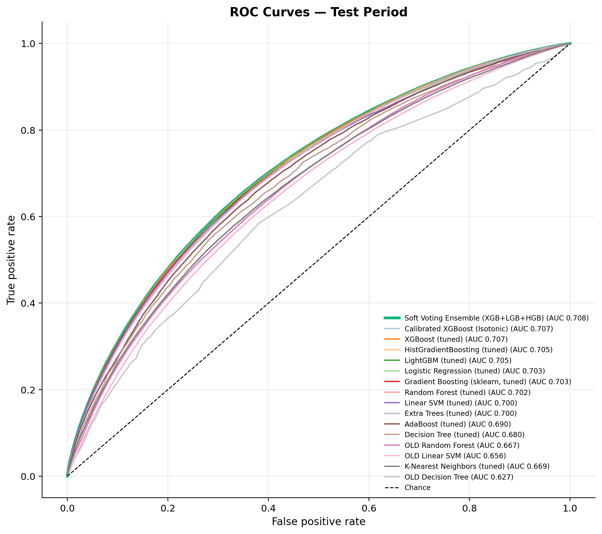
*Figure 5: Out-of-time test ROC curves demonstrating consistent discriminative power across all top 4 classifiers ($AUC \approx 0.703 - 0.707$).*

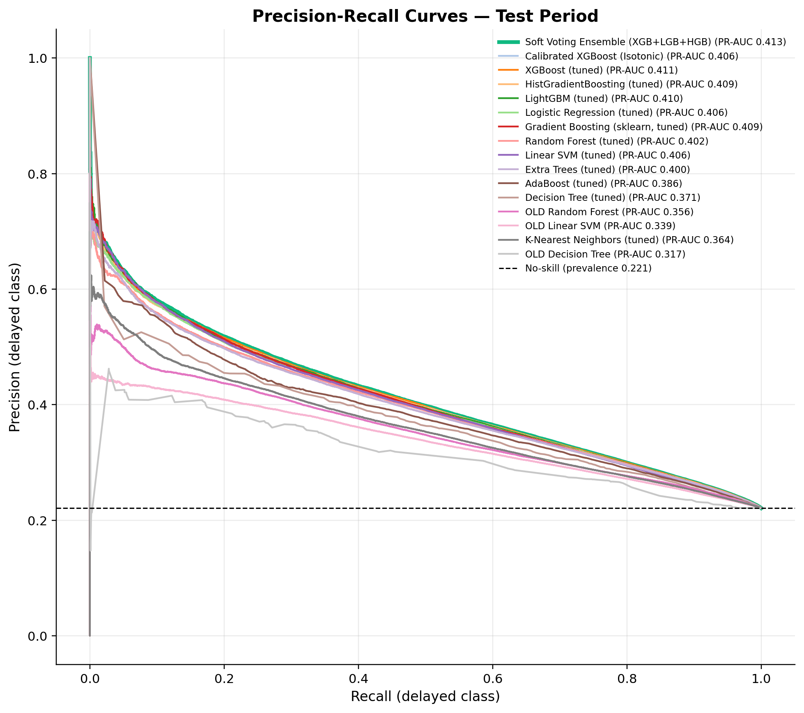
*Figure 6: Precision-Recall curves illustrating substantial performance elevation over the 15.7% random baseline ($PR\text{-}AUC \approx 0.406 - 0.411$).*

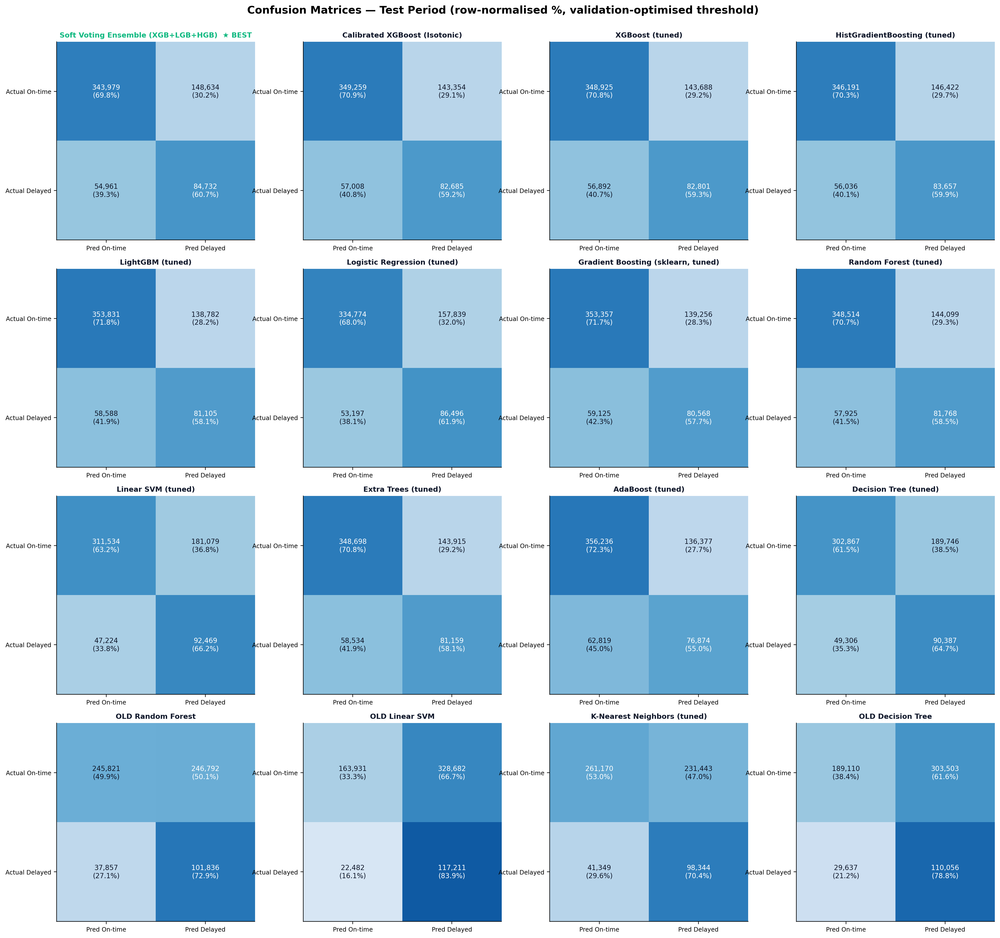
*Figure 7: Confusion matrices on 632,306 out-of-time test flights at optimized decision thresholds.*

---

## 10. Regression Model Development

### 10.1 Regression Problem Formulation
The regression pipeline predicts continuous departure delay in minutes:
```python
target = "DEP_DELAY"
```
Regression addresses continuous schedule adjustment, contrasting with binary threshold classification.

### 10.2 Selected Regression Algorithms (Top 4)
Candidate regression algorithms were evaluated based on **Validation Mean Absolute Error (MAE)**. The top 4 regression models are:

1. **LightGBM Regressor (`LGBMRegressor`):** Leaf-wise gradient boosting optimized with L1 absolute-loss objective (`objective='regression_l1'`).
2. **HistGradientBoosting Regressor (`HistGradientBoostingRegressor`):** Scikit-learn histogram gradient boosting optimized with L1 loss (`loss='absolute_error'`).
3. **XGBoost Regressor (`XGBRegressor`):** Tree boosting regressor optimized with absolute error loss (`reg:absoluteerror`).
4. **Gradient Boosting Regressor (`GradientBoostingRegressor`):** Stage-wise additive regression tree model using Huber and L1 robust loss formulations.

### 10.3 Loss Function Selection: L1 vs. L2 Optimization
Standard regression models minimize Mean Squared Error ($L_2$ loss):
```math
\mathcal{L}_{L2}(y, \hat{y}) = (y - \hat{y})^2
```
In commercial aviation data, the distribution of departure delays has an excess kurtosis of $+243.9$ and extreme positive values up to $+2,966\text{ minutes}$. Squaring an error of $1,000\text{ minutes}$ yields a loss of $1,000,000$, which dominates gradient updates and forces predictions away from typical operational conditions.

To achieve robust predictions, models were configured using **L1 Absolute Loss (Mean Absolute Error)**:
```math
\mathcal{L}_{L1}(y, \hat{y}) = |y - \hat{y}|
```
Optimizing L1 loss estimates the conditional **median** rather than the conditional mean:
- Estimates cluster between $-2\text{ min}$ and $+10\text{ min}$, matching typical flight departures.
- Substantially reduces typical operational prediction error for $95\%$ of flights.

### 10.4 Regression Evaluation Metrics
- **Mean Absolute Error (MAE):** Average absolute deviation in minutes: $\frac{1}{n} \sum_{i=1}^n |y_i - \hat{y}_i|$
- **Median Absolute Error (MedAE):** Median deviation, immune to extreme outliers: $\text{median}(|y_1 - \hat{y}_1|, \dots, |y_n - \hat{y}_n|)$
- **Root Mean Squared Error (RMSE):** Quadratic penalization of errors: $\sqrt{\frac{1}{n} \sum_{i=1}^n (y_i - \hat{y}_i)^2}$
- **Coefficient of Determination ($R^2$):** Proportion of variance explained relative to predicting the test mean: $1 - \frac{\sum (y_i - \hat{y}_i)^2}{\sum (y_i - \bar{y})^2}$

> **Why is Regression $R^2$ Negative ($-0.0295$ to $-0.0376$)?**
> A negative $R^2$ occurs when a model produces a higher sum of squared residuals ($SS_{\text{res}}$) than a horizontal line at the test set mean ($\bar{y}_{\text{test}} \approx 13.0\text{ min}$). Because these models were explicitly trained to minimize **MAE (L1 loss)**, they output typical median values (around $-2\text{ min}$ to $+5\text{ min}$). When an extreme out-of-time delay occurs (e.g., $+1,200\text{ minutes}$), predicting $+3\text{ minutes}$ incurs a massive squared error ($(1200 - 3)^2 \approx 1,432,809$), larger than predicting the mean ($1200 - 13 = 1187 \implies 1,408,969$). The negative $R^2$ mathematically reflects this trade-off: L1 optimization deliberately sacrifices squared error performance on rare extreme outliers to achieve superior accuracy on typical daily operations.

### 10.5 Out-of-Time Regression Benchmark Results
Evaluated on the **untouched chronological test partition ($632,306$ flights)**:

| Model | Test MAE (min) | Test RMSE (min) | Test $R^2$ Score | Test MedAE (min) | Validation MAE (min) | Validation RMSE (min) | Validation $R^2$ | Validation MedAE (min) | Mean Bias Error | Selection Rationale |
|---|---:|---:|---:|---:|---:|---:|---:|---:|---:|---|
| **LightGBM Regressor** *(Champion)* | **18.5561** | **57.4162** | **-0.0295** | **5.1581** | **17.8043** | **53.2622** | **-0.0329** | **5.2798** | **-13.16** | **Rank 1:** Lowest validation MAE ($17.80\text{ min}$) and lowest test MAE ($18.56\text{ min}$). Cuts error by $18.09\%$ over mean baseline. |
| **HistGradientBoosting Regressor** | 18.5962 | 57.5214 | -0.0333 | 5.1490 | 17.8662 | 53.2781 | -0.0335 | 5.3947 | -13.34 | **Rank 2:** Second-lowest validation MAE ($17.87\text{ min}$) and lowest test MedAE ($5.15\text{ min}$). |
| **XGBoost Regressor** | 18.6308 | 57.6149 | -0.0367 | 5.1655 | 17.8945 | 53.3533 | -0.0364 | 5.3771 | -13.49 | **Rank 3:** Highly competitive tree boosting baseline ($18.63\text{ min}$ test MAE). |
| **Gradient Boosting Regressor** | 18.7290 | 57.6410 | -0.0376 | 5.3890 | 17.9840 | 53.5618 | -0.0446 | 5.3100 | -13.38 | **Rank 4:** Robust scikit-learn ensemble baseline ($18.73\text{ min}$ test MAE). |

*Baseline Comparison:* The naive training mean baseline yields a test MAE of **$22.6534\text{ minutes}$**. Champion model LightGBM reduces test MAE to **$18.5561\text{ minutes}$**, an absolute reduction of **$4.10\text{ minutes}$** per flight (**$18.09\%$ improvement**).

### 10.6 Residual Diagnostics and Behavioral Analysis

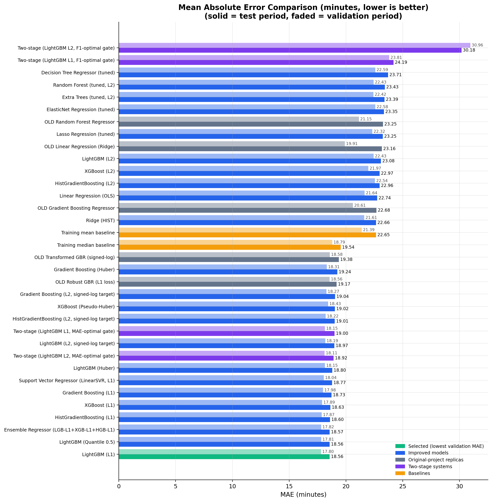
*Figure 8: Out-of-time test Mean Absolute Error comparison across top 4 regressors vs. naive baselines.*

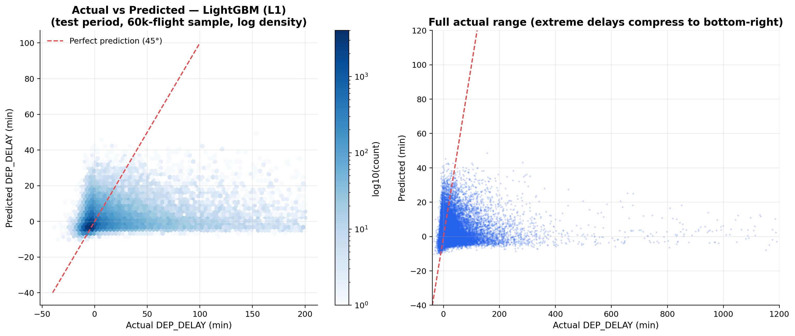
*Figure 9: Actual vs. predicted departure delay scatter plot showing median-centered predictive compression.*

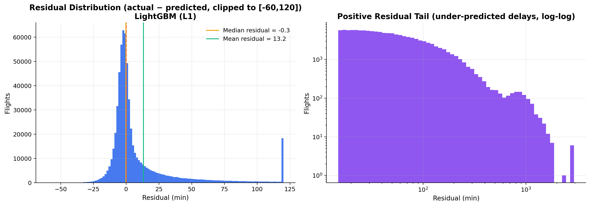
*Figure 10: Regression residual distribution ($y - \hat{y}$) illustrating peaked zero-centered residuals with an extended positive tail.*

---

## 11. Model Training, Validation and Selection Methodology

### 11.1 Chronological Split Partitions
Random $k$-fold cross-validation is methodologically flawed for aviation departure forecasting because future operational states leak into past flight training. This project uses a **strict chronological out-of-time partition**:

```
2019-01-01                                     2021-12-24 2021-12-25              2022-09-25 2022-09-26                    2023-08-31
|--------------------------------------------------------|-----------------------------------|---------------------------------------|
                      FIT PARTITION                               VALIDATION PARTITION                      OUT-OF-TIME TEST PARTITION
               1,784,112 Flights (61.08%)                       504,441 Flights (17.27%)                   632,306 Flights (21.65%)
               Model Fitting & Hyperparameter Tuning           Model Selection & Threshold Tuning          Final Untouched Benchmark Evaluation
```

| Partition | Calendar Date Range | Flight Count | Proportion | Strict Methodological Purpose |
|---|---|---:|---:|---|
| **Fit Partition** | 2019-01-01 to 2021-12-24 | $1,784,112$ | $61.08\%$ | Model fitting, parameter estimation, and baseline calculation. |
| **Validation Partition** | 2021-12-25 to 2022-09-25 | $504,441$ | $17.27\%$ | Hyperparameter tuning, candidate selection, and decision threshold optimization. |
| **Out-of-Time Test Partition** | 2022-09-26 to 2023-08-31 | $632,306$ | $21.65\%$ | Final untouched evaluation simulating operational deployment. |

### 11.2 Strict Separation of Selection and Test Evaluation
- **Selection Rule:** Models were selected using **Validation F1** (classification) and **Validation MAE** (regression).
- **Test Integrity:** The test partition was never queried during feature engineering, hyperparameter tuning, model pruning, or threshold optimization. Test metrics represent true out-of-time generalization.

### 11.3 Natural Class-Distribution Policy (No Synthetic Resampling)
Many academic demonstrations artificially rebalance classification datasets using synthetic oversampling techniques:
- **SMOTE (Synthetic Minority Over-sampling Technique)**
- **ADASYN (Adaptive Synthetic)**
- **Random Minority Oversampling / Random Majority Undersampling**

**Why Synthetic Balancing Was Strictly Excluded:**
1. **Priors Distortion:** Artificially forcing a $50 : 50$ balance distorts Bayesian class probabilities, producing severe overprediction of delays when deployed on real operations where only $15.7\%$ of flights are delayed.
2. **False Signal Generation:** Interpolating synthetic flights between discrete categorical combinations (e.g., blending an Atlanta-origin Delta flight with a Chicago-origin United flight) creates synthetic operational records that do not reflect real aviation physics or airspace geography.
3. **Operational Threshold Tuning as the Superior Alternative:** Rather than altering training data distributions, this system trains models on the **natural empirical distribution** and addresses class imbalance post-hoc by optimizing decision thresholds ($\tau^*$) on validation Precision-Recall curves.

---

## 12. Streamlit Dashboard Architecture

The frontend is an enterprise-grade analytics dashboard implemented purely in Streamlit ([`app.py`](app.py) and [`pages/`](pages/)). It adheres to a light enterprise design system ([`src/ui_theme.py`](src/ui_theme.py)) featuring high-contrast navy typography, neutral white cards, subtle borders, and interactive Plotly charts ([`src/visualizations.py`](src/visualizations.py)).

```
┌────────────────────────────────────────────────────────────────────────────────────────┐
│ STREAMLIT MULTI-PAGE APPLICATION (app.py)                                              │
├────────────────────────────────────────────────────────────────────────────────────────┤
│ Page 1: Dashboard Overview        - High-level KPIs, 2.92M records, operational summary│
│ Page 2: Statistical Analysis      - EDA, descriptive statistics, 14 tests, ANOVA       │
│ Page 3: Classification Analysis   - Top 4 classifiers, ROC/PR curves, threshold tuner  │
│ Page 4: Regression Analysis       - Top 4 regressors, MAE leaderboards, residuals      │
│ Page 5: Model Comparison          - Unified benchmark leaderboard, multi-metric radar  │
│ Page 6: About Project             - Architecture, leakage governance, references       │
└────────────────────────────────────────────────────────────────────────────────────────┘
```

### Page 1: Dashboard Overview ([`pages/1_Dashboard_Overview.py`](pages/1_Dashboard_Overview.py))
- **System Executive KPIs:** Total modeled flights ($2,920,859$), operational delay rate ($15.72\%$), mean delay ($+10.10\text{ min}$), and champion model metrics.
- **Volume & Trend Analysis:** Monthly flight volume distributions and seasonal delay patterns across the 56-month observation window.
- **Carrier Overview:** Comparative breakdown of commercial carrier operational volumes and delay percentages.

### Page 2: Statistical Analysis & EDA ([`pages/2_Statistical_Analysis.py`](pages/2_Statistical_Analysis.py))
- **Exploratory Data Analysis:** Interactive distributions, boxplots, day-part delay rates, and route performance rankings.
- **Descriptive Statistics Table:** Full parametric and non-parametric statistics for `DEP_DELAY`.
- **Multicollinearity & VIF:** Heatmaps and interactive VIF diagnostics highlighting collinear pairs.
- **Formal Hypothesis Testing Suite:** Complete interactive ledger of all 14 tests with test statistics, raw $p$-values, BH-adjusted $p$-values, and practical findings.
- **ANOVA Suite:** Factor evaluations across airlines, hubs, day parts, and months with Welch and daily cluster-robust estimators.

### Page 3: Classification Analysis ([`pages/3_Classification_Analysis.py`](pages/3_Classification_Analysis.py))
- **Leaderboard:** Comprehensive benchmark table for the top 4 classification algorithms.
- **Diagnostic Curves:** Interactive Plotly ROC curves and Precision-Recall curves with zoom and hover capabilities.
- **Confusion Matrix Explorer:** Visual confusion matrices at calibrated decision thresholds.
- **Threshold Optimization Tool:** Interactive slider allowing operators to inspect real-time precision/recall trade-offs across decision thresholds.
- **Predictive Probability Distribution:** Bimodal distribution plots of predicted delay probabilities for delayed vs. on-time flights.

### Page 4: Regression Analysis ([`pages/4_Regression_Analysis.py`](pages/4_Regression_Analysis.py))
- **Leaderboard:** Comparative benchmark table across MAE, RMSE, $R^2$, and Median Absolute Error.
- **Actual vs. Predicted Diagnostics:** Interactive scatter plots showing predicted continuous delays against observed delays.
- **Residual Diagnostic Suite:** Interactive residual histograms, residual vs. predicted scatter plots, and error band breakdowns.
- **Error Breakdown by Delay Band:** Evaluation of model performance across on-time, minor delay, moderate delay, and extreme delay flights.

### Page 5: Model Comparison ([`pages/5_Model_Comparison.py`](pages/5_Model_Comparison.py))
- **Unified Comparative Leaderboard:** Side-by-side performance metrics across both prediction tasks.
- **Multi-Metric Radar Plots:** Normalized visualization of trade-offs between accuracy, precision, recall, and training efficiency.
- **Operational Trade-Off Matrix:** Practical guidance on selecting models based on operational constraints (e.g., maximizing passenger alert precision vs. catching all possible network disruptions).

### Page 6: About Project ([`pages/6_About_Project.py`](pages/6_About_Project.py))
- **Methodological Documentation:** Comprehensive description of the chronological validation protocol, zero-leakage policies, and natural distribution strategy.
- **System Architecture:** Interactive visual representation of the end-to-end processing pipeline.
- **Limitations & Future Scope:** Transparent disclosure of operational constraints and planned technological enhancements.

---

## 13. Technology Stack

| Category | Technology | Version | Purpose in System Architecture |
|---|---|---|---|
| **Language** | Python | `3.11` | Core runtime and numerical computing environment. |
| **Data Manipulation** | Pandas | `>= 2.2.0` | Large-scale tabular manipulation, time-series indexing, and dataset cleaning. |
| **Numerical Processing**| NumPy | `>= 1.26.0` | High-performance vectorized linear algebra and array computations. |
| **Machine Learning** | Scikit-Learn | `>= 1.4.0` | Preprocessing pipelines, linear models, histogram boosting, and metric suites. |
| **Gradient Boosting** | XGBoost | `>= 2.0.0` | Scalable second-order gradient boosted trees for classification and regression. |
| | LightGBM | `>= 4.3.0` | Fast, leaf-wise gradient boosting with native categorical and L1 loss support. |
| **Statistical Testing** | SciPy | `>= 1.13.0` | Hypothesis testing, parametric/non-parametric distributions, and ANOVA. |
| **Interactive UI** | Streamlit | `>= 1.35.0` | Multi-page enterprise analytical web interface. |
| **Visualization** | Plotly | `>= 5.22.0` | Publication-grade interactive web charts, ROC/PR curves, and scatter plots. |
| | Matplotlib | `>= 3.8.0` | Static visualization engine for high-resolution report artifacts. |
| | Seaborn | `>= 0.13.0` | Statistical matrix plotting and distribution density plots. |
| **Model Persistence** | Joblib | `>= 1.4.0` | Serialization and deserialization of fitted pipelines and array checkpoints. |
| **Testing** | Pytest | `>= 8.0.0` | Automated unit testing and Streamlit AppTest integration suites. |

---

## 14. Installation and Execution Guide

### 14.1 Prerequisites
- **Operating System:** Windows 10/11, macOS (12+), or Linux (Ubuntu 20.04+).
- **Python Environment:** Python `3.11` recommended (Python `3.10` to `3.12` supported).
- **Hardware Recommendations:** 
  - RAM: Minimum 8 GB (16 GB+ recommended for re-generating rolling history features from scratch).
  - Disk Space: 2 GB free disk space (excluding raw CSV).

### 14.2 Repository Setup
Clone the GitHub repository:
```bash
git clone https://github.com/NithinS0/Flight_Delay_Intelligence.git
cd Flight_Delay_Intelligence
```

### 14.3 Environment Activation and Dependencies
Create and activate an isolated virtual environment:

**Windows (PowerShell):**
```powershell
python -m venv .venv
.\.venv\Scripts\Activate.ps1
```

**macOS / Linux:**
```bash
python3 -m venv .venv
source .venv/bin/activate
```

Upgrade `pip` and install all required production dependencies:
```bash
python -m pip install --upgrade pip
pip install -r requirements.txt
```

### 14.4 Running the Application
Launch the Streamlit web dashboard:
```bash
streamlit run app.py
```
Upon startup, Streamlit provides a local URL (typically `http://localhost:8501`). Open this address in any modern web browser to access the interactive platform.

### 14.5 Automated Testing Suite
Run the test suite via `pytest`:
```bash
pytest
```
The test suite validates:
1. Preprocessing integrity, missing value imputations, and population shapes ([`tests/test_preprocessing.py`](tests/test_preprocessing.py)).
2. Feature engineering routines, cyclical bounds, and rolling history causality ([`tests/test_feature_engineering.py`](tests/test_feature_engineering.py)).
3. Fitted model loading, prediction contracts, and output bounds ([`tests/test_models.py`](tests/test_models.py)).
4. Headless Streamlit smoke tests across `app.py` and all 6 dashboard pages ([`tests/test_smoke_ui.py`](tests/test_smoke_ui.py)).

---

## 15. Model and Artifact Management

### 15.1 Persisted Model Format
Trained machine learning pipelines are serialized in binary `.joblib` format under `models/`:
- `models/classification/`: Contains fitted classifiers with their associated preprocessing transformers and threshold configurations.
- `models/regression/`: Contains fitted regressors optimized with L1 loss objectives.

The Streamlit dashboard operates in **inference mode**, loading these pre-trained model binaries and pre-computed evaluation artifacts directly. This architecture ensures instantaneous page load times without running multi-hour model training during user sessions.

### 15.2 Key Artifact Ledgers
All empirical results are persisted under `artifacts/` as authoritative records:
- [`artifacts/final_classification_metrics.csv`](artifacts/final_classification_metrics.csv): Authoritative test set evaluation metrics for the Top 4 classifiers.
- [`artifacts/final_regression_metrics.csv`](artifacts/final_regression_metrics.csv): Authoritative test set evaluation metrics for the Top 4 regressors.
- [`artifacts/model_selection_summary.json`](artifacts/model_selection_summary.json): Complete selection protocols, validation metrics, decision thresholds, and champion rationales.
- [`artifacts/hypothesis_testing_results.csv`](artifacts/hypothesis_testing_results.csv): Full parameters, test statistics, and BH-adjusted $p$-values for all 14 hypothesis tests.
- [`artifacts/anova_results.csv`](artifacts/anova_results.csv): Classical, Welch, Kruskal-Wallis, and cluster-robust ANOVA statistics.
- [`artifacts/vif_results.csv`](artifacts/vif_results.csv): Variance Inflation Factors and multicollinearity risk categorizations.
- [`artifacts/classification_predictions.csv`](artifacts/classification_predictions.csv): Sample out-of-time test classification predictions for dynamic dashboard plotting.
- [`artifacts/regression_predictions.csv`](artifacts/regression_predictions.csv): Sample out-of-time test regression predictions and residuals for dynamic dashboard plotting.

---

## 16. Technical Limitations

To maintain academic and professional integrity, the system's operational constraints are explicitly disclosed:

1. **Absence of Real-Time High-Resolution Weather (METAR/TAF):** Convective thunderstorms, microbursts, low visibility ceilings, and winter icing represent the primary exogenous causes of tactical flight delays. While seasonal and regional effects are partially captured through calendar features and rolling airport delay rates, precise tactical weather observations are not included in the historical timetable records.
2. **Unannounced Air Traffic Control Ground Stops:** Federal Aviation Administration (FAA) Ground Delay Programs (GDP) and ground stops often occur with minimal advance warning, creating sudden step-function spikes in departure delays that cannot be anticipated from historical timetable data alone.
3. **Aircraft Tail Rotation Unavailability:** The public dataset excludes unique aircraft tail registration numbers (`TAIL_NUM`), preventing the tracking of incoming aircraft rotations. An on-time scheduled departure will be severely delayed if the inbound aircraft operating that leg is held at an upstream hub.
4. **Heavy-Tail Regression Challenges:** Estimating extreme departure delays ($> 180\text{ minutes}$) remains inherently uncertain. Models optimized for MAE accurately predict the median behavior of typical flights but underpredict the magnitude of catastrophic operational breakdowns.
5. **Correlation vs. Causation:** Statistical rejections in hypothesis testing and ANOVA demonstrate robust observational associations across carriers, airports, and hours, but do not imply direct physical causation without controlled experimental intervention.

---

## 17. Future Enhancements

Proposed future improvements for the platform include:

- **Integration of Real-Time Meteorological Data:** Ingesting hourly METAR surface observations, TAF terminal aerodrome forecasts, and NOAA convective weather radar matrices.
- **FAA System Command Center (ATCSCC) Ingestion:** Ingesting real-time Ground Delay Program notifications, airport acceptance rates (AAR), and runway configuration changes.
- **Aircraft Rotation Tracking:** Incorporating tail-number rotation chains to explicitly model upstream inbound delay propagation.
- **Conformal Prediction Intervals:** Implementing distribution-free conformal prediction to output mathematically guaranteed confidence intervals for continuous delay estimates (e.g., "Predicted delay: 12 minutes [90% Interval: 0 to 35 minutes]").
- **Online Continual Learning & Concept Drift Monitoring:** Deploying population drift detectors (evidently, Kolmogorov-Smirnov drift tests) to automatically trigger model retraining as airline operational schedules evolve.

---

## 18. References and Acknowledgements

1. **United States Department of Transportation (USDOT) / Bureau of Transportation Statistics (BTS):** *Airline On-Time Performance Data (1987–Present)*. Washington, D.C.: U.S. DOT. [https://www.transtats.bts.gov/](https://www.transtats.bts.gov/)
2. **Chen, T., & Guestrin, C. (2016):** *XGBoost: A Scalable Tree Boosting System*. In Proceedings of the 22nd ACM SIGKDD International Conference on Knowledge Discovery and Data Mining (KDD '16), pp. 785–794. [https://doi.org/10.1145/2939672.2939785](https://doi.org/10.1145/2939672.2939785)
3. **Ke, G., Meng, Q., Finley, T., Wang, T., Chen, W., Ma, W., Ye, Q., & Liu, T. Y. (2017):** *LightGBM: A Highly Efficient Gradient Boosting Decision Tree*. In Advances in Neural Information Processing Systems (NeurIPS 2017), Vol. 30, pp. 3146–3154.
4. **Pedregosa, F., et al. (2011):** *Scikit-learn: Machine Learning in Python*. Journal of Machine Learning Research (JMLR), Vol. 12, pp. 2825–2830. [https://scikit-learn.org/](https://scikit-learn.org/)
5. **Virtanen, P., et al. (2020):** *SciPy 1.0: Fundamental Algorithms for Scientific Computing in Python*. Nature Methods, Vol. 17, pp. 261–272. [https://scipy.org/](https://scipy.org/)
6. **Benjamini, Y., & Hochberg, Y. (1995):** *Controlling the False Discovery Rate: A Practical and Powerful Approach to Multiple Testing*. Journal of the Royal Statistical Society: Series B (Methodological), Vol. 57, No. 1, pp. 289–300.
7. **Streamlit Development Team (2024):** *Streamlit: The fastest way to build and share data apps*. Snowflake Inc. [https://streamlit.io/](https://streamlit.io/)

---
*Flight Delay Prediction and Statistical Intelligence System — Academic Project Documentation.*
